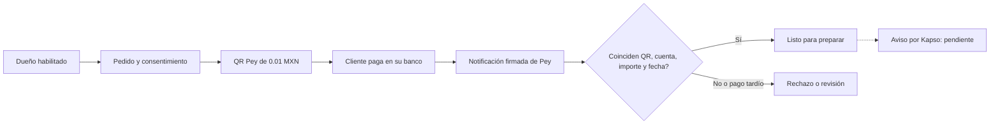

# Pey + WhatsApp

Cobros conversacionales para negocios: registrar un negocio, compartir un cobro o anticipo y conocer su resultado sin pedir una captura del comprobante.

**Caso del hackathon:** pedido → cobro → pago confirmado por Pey → pedido **listo para preparar**, sin repetir la transición por entregas duplicadas.

**Aplicación:** https://hackathon.filmjx.com · [Dirección alternativa](https://repo-to-pey-deploy.lovable.app)

> **Estado al 15 de noviembre de 2026:** la conversación y el banco de la demo son simulados. El flujo aislado de pedidos reales de **$0.01 MXN** está implementado, pero necesita habilitación y una prueba completa con Pey. WhatsApp real con Kapso sigue pendiente. Esta documentación no certifica un pago real ni que la última versión esté publicada.

## Documentación

| Guía | Contenido |
| --- | --- |
| [Arquitectura y diagramas](docs/arquitectura.md) | Componentes, secuencia de pago, estados y datos |
| [Configuración y operación](docs/configuracion.md) | Desarrollo local, conexiones, acceso del dueño y notificaciones |
| [Demo y pruebas](docs/pruebas.md) | Recorrido reproducible, pruebas automatizadas y evidencia pendiente |
| [Seguridad y casos especiales](docs/seguridad.md) | Firmas, duplicados, pagos tardíos y fallos |
| [Entrega del hackathon](docs/hackathon.md) | Descripción, guion y lista de entrega |
| [Trabajo pendiente](roadmap.md) | Activación de pagos y WhatsApp |

## Qué funciona y qué falta

| Capacidad | Estado |
| --- | --- |
| Registro y vinculación de cuenta ficticia | Demo funcional |
| Chat negocio/cliente, cobros completos y anticipos | Demo funcional; no envía WhatsApp |
| Banco simulado: pagar, rechazar o vencer | Demo funcional; no mueve dinero |
| QR demo, cuenta regresiva, sonido opcional y celebración | Presentación funcional; QR no bancario |
| Repetición de eventos de demo | Control disponible para comprobar duplicados |
| Acceso del dueño y pedidos reales de $0.01 MXN | Implementado; requiere usuario y operador habilitados |
| Creación de QR Pey y conciliación firmada | Implementado; pendiente de configuración y prueba real |
| Acción posterior al pago | Transición atómica a `READY`; no despacha a una cocina externa |
| Envío/recepción de WhatsApp con Kapso | Pendiente; receptor guarda eventos válidos pero responde 503 |
| Notas de voz, fotos de tickets, IA y reportes por WhatsApp | No implementados |
| Reembolsos automáticos y alta real de cuentas | No implementados |

## Flujo principal



El diagrama describe el flujo **preparado**, no evidencia de un pago ejecutado. La demo pública usa otro conjunto de datos y controles simulados.

## Probar la demo

1. Abre la aplicación y registra un negocio desde el chat del negocio.
2. Vincula la cuenta **ficticia** y activa la cuenta desde los controles de demo.
3. Crea un cobro, revisa el resumen y confirma.
4. Comparte con el cliente demo y abre el banco simulado.
5. Simula el pago; comprueba el recibo y repite el evento para revisar que no se suma otro pago.

Para un ejemplo de anticipo de $350 sobre un total de $1,000 y escenarios de rechazo/vencimiento, consulta [la guía de pruebas](docs/pruebas.md).

## Desarrollo

Stack: TanStack Start, React, TypeScript, Tailwind CSS, Lovable Cloud y Vitest. Las llamadas privadas a Pey y Kapso pasan por conexiones del lado del servidor. No es un despliegue directo del proyecto original NestJS ni del bot Python de referencia.

```sh
bun install
bun run dev
bun run test
```

Las conexiones administradas del entorno alojado no se trasladan automáticamente al desarrollo local. Consulta [configuración](docs/configuracion.md) antes de probar funciones conectadas. Nunca copies claves privadas al navegador o al repositorio.

## Referencias

- [Documentación de Pey](https://docs.pey.mx/)
- [Kapso](https://kapso.ai/)
- [Varísimo / CoDi Informal](https://github.com/G10hdz/codi-informal): referencia para la organización de documentación y el recorrido WhatsApp → cobro → confirmación; sus capacidades y evidencias no se atribuyen a este proyecto.

Los diagramas están escritos en Mermaid y se pueden visualizar en GitHub. No contienen claves, cuentas bancarias reales ni información de clientes.