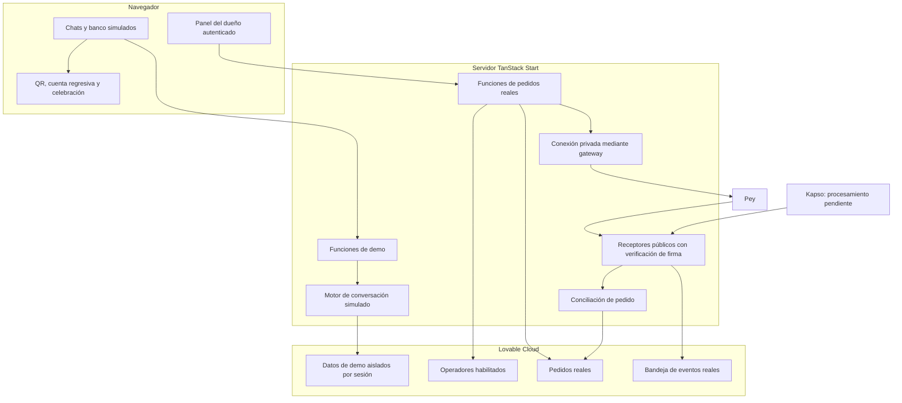
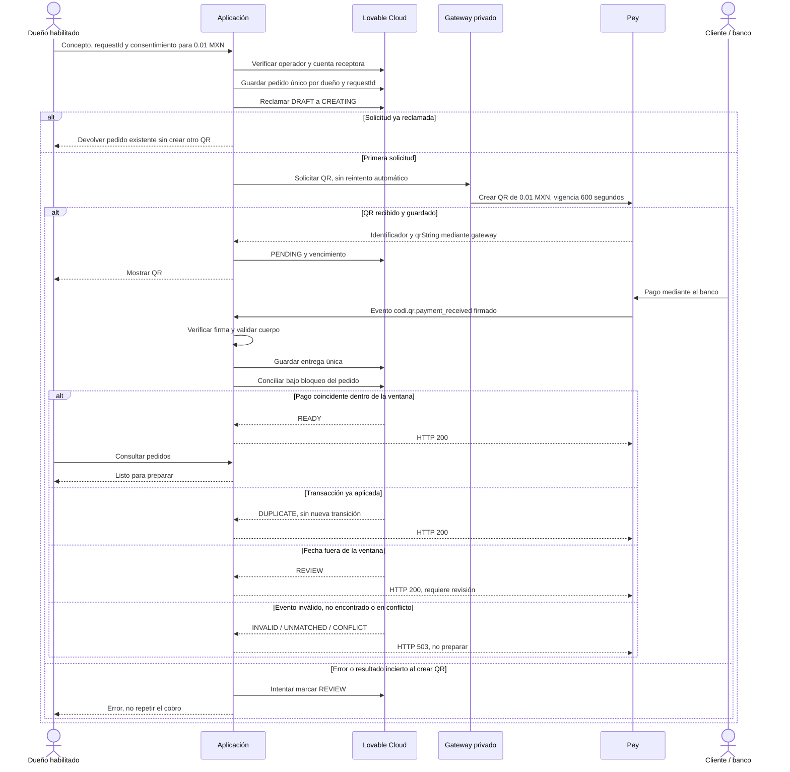
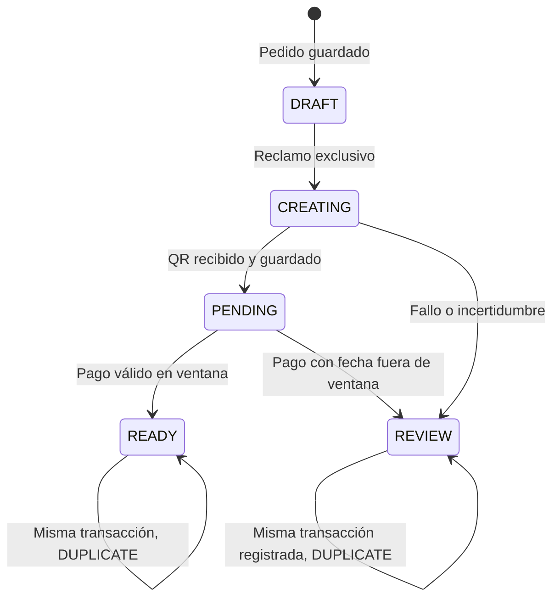
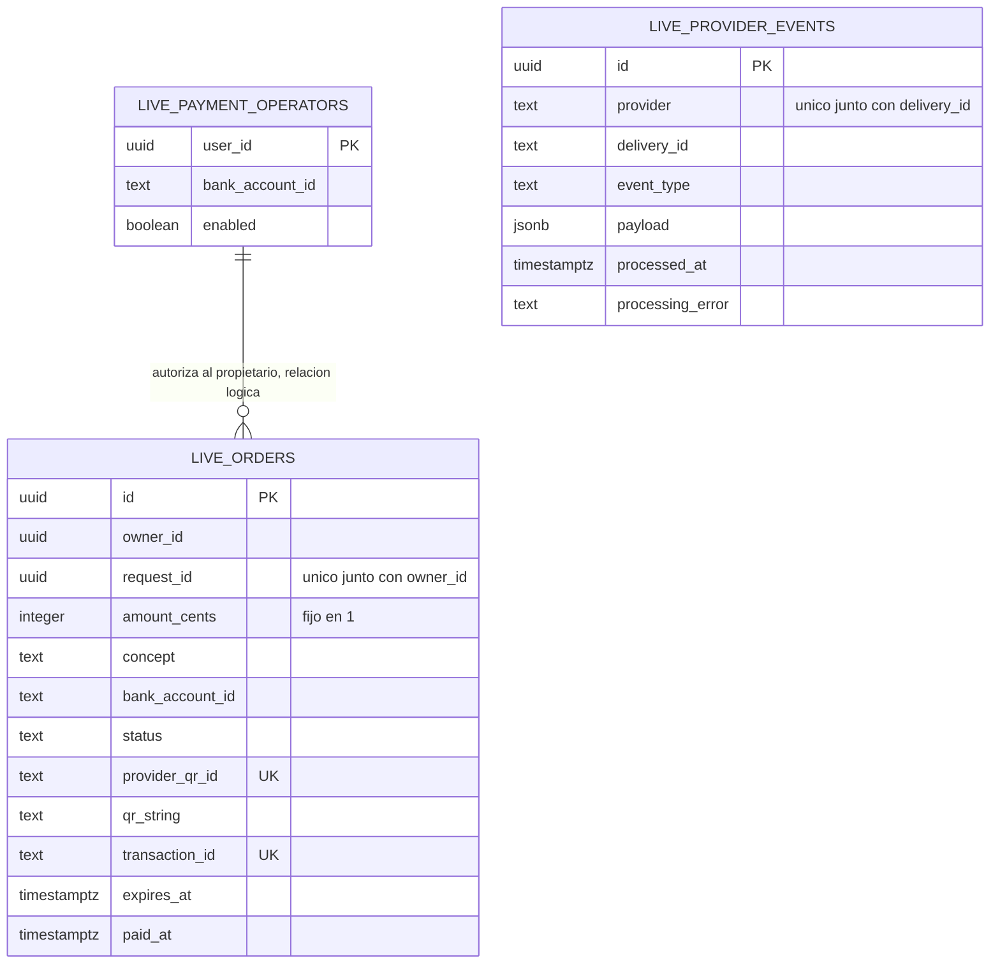

# Arquitectura y diagramas

[Volver al README](../README.md)

## 1. Componentes y separación de entornos

- **Demo:** sesión anónima mediante cookie `pey_demo` httpOnly; las funciones de servidor comprueban la sesión y el alcance de sus datos. No hay acceso público directo a esas tablas.
- **Pedidos reales:** requieren sesión del dueño y registro habilitado en `live_payment_operators`. La cuenta receptora se toma del servidor, no de un campo editable por el visitante.
- **Conexiones:** claves privadas solo en servidor, con gateway de conexiones. La demo no realiza llamadas reales a proveedores.
- **Notificaciones:** Pey y Kapso tienen receptores separados; la bandeja de eventos reales nunca cambia los cobros de demo.
- **Acción implementada:** actualizar el pedido a `READY`. No hay envío a cocina, entrega, mensaje Kapso ni reserva de agenda como efecto de esa transición.

## 2. Secuencia de un pedido real preparado

El panel vuelve a consultar pedidos cada cinco segundos mientras hay sesión. No hay canal de tiempo real ni cola de trabajos; los eventos se procesan de forma síncrona. Si falla guardar el estado de revisión, el pedido puede permanecer en `CREATING`: también exige revisión manual.

## 3. Estados persistidos de pedidos reales

`QR vencido` es una indicación de pantalla, **no** otro estado de base de datos. Sin evento recibido, un pedido vencido sigue en `PENDING`. `READY` expresa pago conciliado y permiso para preparar; no prueba preparación o entrega física. No existe un estado persistido separado `PAID` en pedidos reales.

## 4. Modelo de datos del flujo real

La relación operador/pedido es lógica; no declara una llave foránea en la migración. La bandeja no tiene una relación física con pedidos: la conciliación cruza `codiQrId` con `provider_qr_id`. Las restricciones únicas de QR y transacción impiden asignar esos identificadores a dos pedidos.

La demo utiliza `demo_runs`, `merchants`, `bank_accounts`, `onboarding_sessions`, `conversations`, `messages`, `charges`, `payment_attempts`, `payments` y `webhook_events`; no reutiliza tablas reales.

## 5. Mapa del código

| Área | Archivo |
| --- | --- |
| Pantalla principal y vinculación ficticia | `src/routes/index.tsx`, `src/routes/vincular.tsx` |
| Panel real del dueño | `src/components/live-orders-panel.tsx` |
| Presentación de QR y celebración | `src/components/payment-experience.tsx` |
| Funciones y motor demo | `src/lib/pey/demo.functions.ts`, `engine.server.ts` |
| Validación del pedido y evento Pey | `src/lib/pey/live-orders.ts` |
| Acceso y creación del pedido | `src/lib/pey/live-orders.functions.ts` |
| Solicitud de QR y llamada a conciliación | `src/lib/pey/live-orders.server.ts` |
| Verificación y bandeja de eventos | `src/lib/pey/live-webhooks.ts`, `live-inbox.server.ts` |
| Receptores HTTP | `src/routes/api/public/pey/webhook.ts`, `src/routes/api/public/kapso/webhook.ts` |
| Tablas y conciliación atómica | `drizzle/migrations/0001_create_live_provider_inbox.sql`, `0002_prepare_live_pey_orders.sql` |

Los diagramas documentan la implementación actual, no la arquitectura NestJS ni Python de los repositorios de origen/referencia.