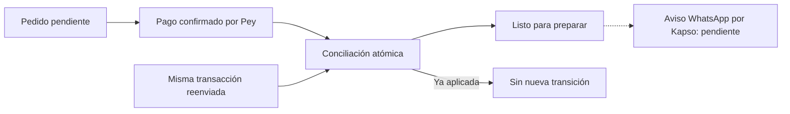

# Entrega del hackathon

[Volver al README](../README.md)

## Descripción propuesta

**Pey + WhatsApp** ayuda a un negocio a convertir una conversación en un cobro verificable. La demo muestra registro, vinculación ficticia, cobros completos y anticipos. El recorrido real preparado crea un pedido de $0.01 MXN y solo lo marca **listo para preparar** cuando llega un pago firmado de Pey que coincide con QR, cuenta, importe y ventana de pago. Los reenvíos de una misma transacción no deben volver a activar la preparación.

WhatsApp real con Kapso está pendiente; la conversación visible hoy es simulada. No se ha documentado aún un pago real completado en esta versión.

## Qué se dispara después del pago

La acción demostrable implementada es el cambio persistido del pedido, no un mensaje real ni una entrega física.

## Guion breve propuesto

1. **Problema:** el negocio necesita saber qué pedidos están pagados sin revisar capturas.
2. **Demo simulada:** mostrar ambos chats, crear un cobro y compartirlo; identificar claramente banco y cuenta ficticios.
3. **Flujo real, cuando esté habilitado:** dueño crea un pedido autorizado de $0.01 MXN y muestra el QR Pey.
4. **Confirmación:** pagar desde el banco, esperar la notificación y mostrar «Listo para preparar» con transacción redactada.
5. **No duplicar:** reenviar la misma entrega si el proveedor lo permite y comprobar que sigue siendo el mismo pedido.
6. **Límites:** explicar pagos tardíos/revisión, ausencia de devolución automática y estado pendiente de Kapso.

Si no hay prueba real, mostrar solo lo preparado y decirlo expresamente; no sustituir la confirmación auténtica por el botón del banco simulado.

## Lista de entrega

- [ ] Nombre del equipo: **por confirmar**.
- [ ] Nombre del proyecto: **Pey + WhatsApp** como título de trabajo actual.
- [ ] Descripción revisada por el equipo.
- [ ] Correos de integrantes: **por proporcionar**, no inventarlos ni publicar datos personales sin autorización.
- [ ] Enlace funcional: https://hackathon.filmjx.com.
- [ ] Última versión publicada y comprobada desde el dominio.
- [ ] Enlace del repositorio privado y acceso permitido a quienes evalúan.
- [ ] Video o evidencia de pago real de $0.01 MXN y acción posterior, con datos sensibles ocultos.
- [ ] Evidencia de reenvío sin doble transición.
- [ ] README y diagramas accesibles para evaluación.
- [ ] Funciones simuladas y pendientes indicadas explícitamente.
- [ ] Fecha y hora límite confirmadas con la convocatoria original; no se infieren del texto parcialmente legible.

## Bloqueos para la demostración real

Usuario del dueño y operador habilitado, cuenta Pey receptora verificada, secreto y alta de notificaciones Pey, prueba completa real y publicación actualizada. Para el recorrido WhatsApp, además número/configuración Kapso y código de envío/recepción.

Consulta [configuración](configuracion.md), [pruebas](pruebas.md) y [trabajo pendiente](../roadmap.md). Esta documentación no activa servicios, no publica el sitio ni crea un repositorio remoto por sí misma.