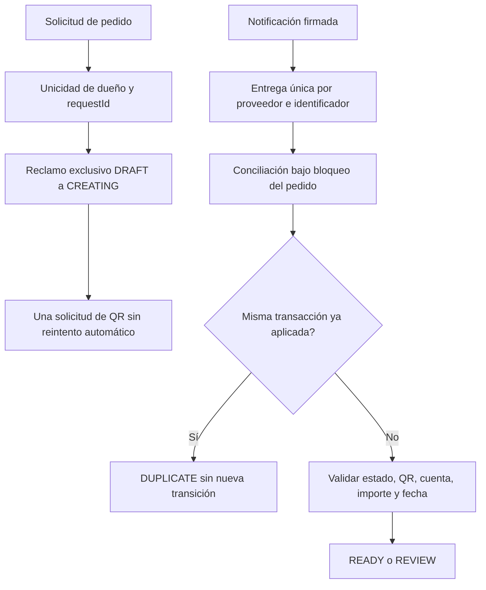

# Seguridad y casos especiales

[Volver al README](../README.md)

## Límites de confianza

- El navegador no decide si un pago real se recibió.
- Una foto, mensaje «ya pagué», clic en el banco demo o QR mostrado no confirma un pedido real.
- Solo una notificación Pey verificada y conciliada puede llevar un pedido real de `PENDING` a `READY`.
- Las operaciones reales requieren dueño autenticado y habilitado; el servidor toma su cuenta receptora asignada.
- El importe real es fijo: **1 centavo / $0.01 MXN**. Se valida en entrada, solicitud Pey, evento y base de datos. Se exige consentimiento explícito al crear.
- Claves de proveedores, firma y acceso privilegiado permanecen en servidor.

## Firmas y datos privados

Pey usa `standardwebhooks`; Kapso usa HMAC-SHA256 sobre el cuerpo original. Se verifica antes de guardar y se limita el cuerpo a 1 MiB. Las tablas tienen RLS: no hay políticas públicas sobre demo o bandeja real; el dueño habilitado solo puede leer sus pedidos y su registro de operador. Los cambios reales se realizan por funciones de servidor después de comprobar autorización.

La bandeja contiene el cuerpo del proveedor: tratarlo como dato privado. No hay política de retención automatizada implementada. No registrar ni publicar secretos, firmas o datos bancarios en documentación, video o capturas.

## Prevención de duplicados

- Pey deduplica entregas por `webhook-id`; Kapso por hash del tipo de evento y cuerpo original.
- Guardar una entrega duplicada no impide volver a intentar su conciliación: sirve si el primer procesamiento falló. La función SQL protege la transición con bloqueo y comprobación de transacción.
- QR y transacción tienen restricciones únicas en pedidos reales.
- La creación de QR no presume que Pey soporte una llave de idempotencia; por eso nunca se reintenta automáticamente tras incertidumbre.
- La garantía actual cubre el estado del pedido. Una futura cocina o notificación externa necesitará su propio efecto persistido e idempotente; no se implementa ni se promete aquí.

## Casos especiales reales

| Caso | Comportamiento actual | Acción operativa |
| --- | --- | --- |
| QR vence sin evento | Sigue `PENDING`; pantalla lo muestra vencido | No preparar; revisar antes de generar otro pedido |
| Notificación llega tarde pero `datePaid` está en ventana | Puede pasar a `READY` | Importa la fecha del pago, no la hora de entrega |
| Pago después de `expires_at` | `REVIEW`, guarda transacción | Revisar; no preparar automáticamente |
| Fecha anterior a creación menos un minuto | `REVIEW` | Investigar coincidencia y tiempo |
| Firma falsa o datos de firma ausentes | HTTP 401, no guarda | No aceptar como pago |
| Cuenta o importe distintos | No cambia a `READY` | Investigar sin alterar el importe autorizado |
| Otro pago para un pedido ya conciliado | Conflicto, no segunda preparación | Conciliación manual |
| Resultado incierto al crear QR | Intenta `REVIEW`; podría quedar `CREATING` si falla guardar | No repetir; revisar en Pey |
| Evento válido antes de guardar QR | `UNMATCHED`, HTTP 503 | Necesita reentrega del proveedor o revisión; no hay trabajador automático |
| Kapso o tipo Pey no soportado | Guarda si está firmado, responde 503 | Integración aún no operativa |
| Falla guardar marca de evento procesado | HTTP 503 aunque el pedido pudo conciliarse | Reentrega segura por comprobación de transacción |
| Solicitud de devolución | Sin automatización | Pruebas no reembolsables; no prometer devolución |

La vigencia solicitada del QR real es 600 segundos y el vencimiento local se calcula desde el inicio de la solicitud. El QR de demo usa su propia vigencia: no confundir ambos recorridos.

## Pendientes de endurecimiento

- Pruebas integradas de RLS, concurrencia y conciliación SQL.
- Límites de solicitudes y controles antiabuso: no hay rate limiting dedicado implementado.
- Herramienta administrativa para resolver/reprocesar eventos y pedidos en revisión.
- Retención y depuración de eventos con datos personales.
- Si se agrega Kapso o preparación externa, garantizar que el efecto posterior también sea deduplicado.

Estos pendientes no deben presentarse como funciones existentes.